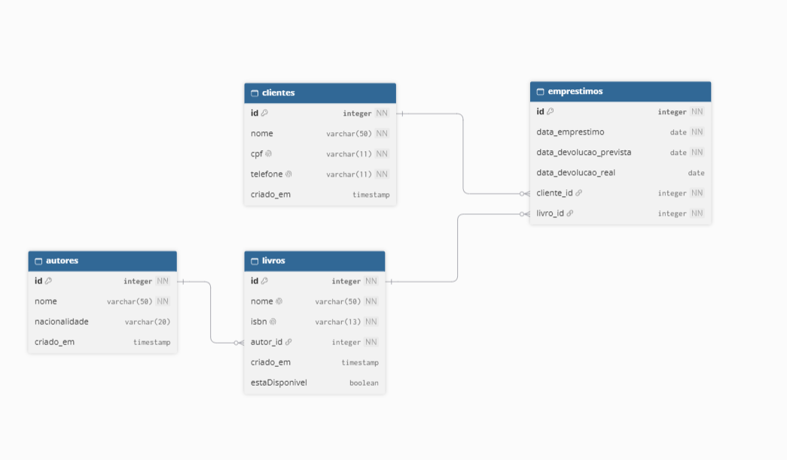

# Bookstore Manager CLI

Aplicação de linha de comando para gerenciamento de uma biblioteca/loja de livros. O sistema permite cadastrar e administrar autores, livros e clientes, além de registrar empréstimos e devoluções. O projeto foi desenvolvido em TypeScript com uma arquitetura em camadas, utilizando repositórios em memória para a execução da aplicação e PostgreSQL como referência para o modelo relacional documentado no arquivo `database/script.sql`.

## Objetivo

O projeto tem como objetivos:

- Organizar o cadastro e a consulta de autores, livros e clientes.
- Controlar a disponibilidade dos livros.
- Registrar empréstimos vinculados a clientes e livros.
- Registrar devoluções e atualizar a disponibilidade dos livros.
- Demonstrar a separação de responsabilidades entre menus, controllers, services, repositories e models.
- Inicializar a aplicação com dados de demonstração por meio do `seed.ts`.

## Tecnologias utilizadas

| Tecnologia/ferramenta | Finalidade |
| --- | --- |
| TypeScript | Implementação da aplicação com tipagem estática. |
| Node.js | Execução da aplicação no terminal. |
| `readline/promises` | Leitura assíncrona das opções e dados digitados pelo usuário. |
| npm | Gerenciamento do projeto e execução dos scripts. |
| TypeScript Compiler (`tsc`) | Compilação dos arquivos `.ts` para JavaScript em `dist/`. |
| PostgreSQL | Execução do modelo relacional e dos comandos SQL presentes em `database/script.sql`. |
| pgAdmin ou `psql` | Ferramentas para criar o banco, executar o script e consultar os dados. |

As dependências de desenvolvimento declaradas no projeto são `typescript` e `@types/node`.

## Requisitos para execução

Para executar a aplicação CLI, são necessários:

- Node.js com suporte a `node:readline/promises`.
- npm.
- As dependências do projeto instaladas com `npm install`.

O projeto não fixa uma versão mínima do Node.js no `package.json`. Portanto, utilize uma versão LTS atual compatível com o módulo `readline/promises`.

O PostgreSQL não é utilizado pela aplicação CLI durante a execução atual, que usa repositórios em memória. Ele é necessário para executar e consultar o arquivo `database/script.sql`.

## Instalação

Clone o repositório e instale as dependências:

```bash
git clone https://github.com/Matheus-Leffa/Bookstore-Manager-CLI
cd bookStoreManagerCLI
npm install
```

## Execução da aplicação

### Compilar e iniciar

Compile o projeto:

```bash
npm run build
```

Esse comando executa o TypeScript Compiler e gera os arquivos JavaScript na pasta `dist/`.

Depois, inicie a aplicação:

```bash
npm start
```

Também é possível compilar e iniciar em um único comando:

```bash
npm run dev
```

Os scripts estão definidos no `package.json`:

- `npm run build`: compila `src/` para `dist/`.
- `npm start`: executa `dist/main.js`.
- `npm run dev`: executa o build e, em seguida, inicia a aplicação.

Ao iniciar, o `main.ts` cria os repositories em memória, instancia services e controllers, executa o seed e abre o menu principal.

## Execução do script SQL no PostgreSQL

O arquivo [database/script.sql](./database/script.sql) contém a criação das tabelas, os relacionamentos, os registros iniciais e consultas de verificação.

### Criar ou selecionar um banco

Pelo `psql`, conecte-se ao PostgreSQL e crie um banco para o projeto:

```sql
CREATE DATABASE bookstore_manager;
```

Depois, conecte-se ao banco:

```bash
psql -U <usuario> -d bookstore_manager
```

No Windows, também é possível abrir o **SQL Shell (psql)**, informar o usuário, servidor, porta e banco, e então executar o script.

### Executar pelo terminal

Com o banco criado e o terminal posicionado na raiz do projeto:

```bash
psql -U <usuario> -d bookstore_manager -f database/script.sql
```

Informe a senha quando solicitado. Se o PostgreSQL estiver em outro host ou porta, utilize as opções correspondentes, por exemplo:

```bash
psql -h <host> -p <porta> -U <usuario> -d bookstore_manager -f database/script.sql
```

### Executar pelo pgAdmin

1. Abra o pgAdmin e conecte-se ao servidor PostgreSQL.
2. Crie ou selecione o banco `bookstore_manager`.
3. Abra o **Query Tool** desse banco.
4. Abra o arquivo `database/script.sql`.
5. Execute o conteúdo do script.
6. Consulte as tabelas criadas para verificar o resultado.

### Verificar tabelas e registros

Ao final, podem ser executadas as consultas de conferência presentes no próprio script:

```sql
SELECT * FROM autores;
SELECT * FROM livros;
SELECT * FROM clientes;
SELECT * FROM emprestimos;
```

O script define as tabelas `autores`, `livros`, `clientes` e `emprestimos`, com chaves estrangeiras ligando livros a autores e empréstimos a clientes e livros. Os comandos `DELETE` e `UPDATE` existentes no arquivo são exemplos de manipulação de dados e não fazem parte do seed em memória da aplicação.

## Diagrama Entidade-Relacionamento

O diagrama entidade-relacionamento está disponível em [database/DER.png](./database/DER.png).



## Arquitetura do projeto

O projeto segue o fluxo:

```text
Menu → Controller → Service → Repository
                         ↓
                       Model
```

### Menu

Os menus implementam a interação com o usuário por meio do terminal e controlam a navegação:

- `MenuGeral`: menu principal.
- `MenuAutores`: operações de autores.
- `MenuLivros`: operações de livros.
- `MenuClientes`: operações de clientes.
- `MenuEmprestimos`: operações de empréstimos e devoluções.

As entradas são recebidas exclusivamente por números para seleção das opções. Os dados das operações são solicitados por `readline/promises`.

### Controller

Os controllers recebem as solicitações dos menus e encaminham as chamadas para os services. Existem controllers para autores, livros, clientes e empréstimos.

### Service

Os services concentram as regras de negócio, validações e coordenação entre repositories. Por exemplo, o `EmprestimoService` valida a existência do cliente e do livro, verifica a disponibilidade do livro e atualiza sua situação após empréstimo ou devolução.

### Repository

Os repositories definem as operações de persistência. A implementação utilizada pela aplicação é em memória:

- `AutorRepositoryMemoria`
- `LivroRepositoryMemoria`
- `ClienteRepositoryMemoria`
- `EmprestimoRepositoryMemoria`

Essas classes armazenam os registros em arrays durante a execução do processo.

### Model

Os models representam as entidades do domínio:

- `Autor`
- `Livro`
- `Cliente`
- `Emprestimo`

Eles armazenam atributos como identificação, dados cadastrais, datas de criação, relacionamentos e disponibilidade dos livros.

### Seed

O arquivo `src/data/seed.ts` inicializa os repositories em memória com os registros definidos nos comandos `INSERT INTO` do script SQL:

- 5 autores.
- 10 livros.
- 3 clientes.
- 9 empréstimos.

Os livros relacionados aos empréstimos iniciais são marcados como indisponíveis. O seed é executado pelo `main.ts` antes da abertura do menu e não reinsere dados quando os repositories já possuem registros.

## Funcionalidades implementadas

### Autores

- Cadastrar autor.
- Buscar autor pelo ID.
- Listar autores.
- Atualizar autor.
- Remover autor pelo ID.
- Exibir a data de criação na listagem.

### Livros

- Cadastrar livro associado a um autor.
- Buscar livro pelo ID.
- Listar livros.
- Atualizar livro.
- Remover livro pelo ID.
- Exibir ISBN, autor, disponibilidade e data de criação.
- Impedir cadastro de ISBN ou nome inválido ou duplicado conforme as regras do service.

### Clientes

- Cadastrar cliente.
- Buscar cliente pelo ID.
- Listar clientes.
- Atualizar cliente.
- Remover cliente pelo ID.
- Exibir CPF, telefone e data de criação.
- Validar nome, CPF e telefone conforme as regras do service.

### Empréstimos

- Realizar empréstimo informando o ID do cliente e o ID do livro.
- Buscar empréstimo pelo ID.
- Listar empréstimos.
- Registrar devolução pelo ID do empréstimo.
- Atualizar a disponibilidade do livro após empréstimo ou devolução.
- Exibir a data do empréstimo e a data da devolução, quando registrada.
- Impedir empréstimo de livro indisponível.

## Estrutura de pastas

```text
bookStoreManagerCLI/
├── database/
│   ├── DER.png
│   └── script.sql
├── src/
│   ├── controllers/
│   │   ├── AutorController.ts
│   │   ├── ClienteController.ts
│   │   ├── EmprestimoController.ts
│   │   └── LivroController.ts
│   ├── data/
│   │   └── seed.ts
│   ├── exceptions/
│   │   ├── AutorNameInvalidError.ts
│   │   ├── AutorNotFoundError.ts
│   │   ├── ClienteCpfAlreadyExistsError.ts
│   │   ├── ClienteCpfInvalidError.ts
│   │   ├── ClienteNameInvalidError.ts
│   │   ├── ClienteNotFoundError.ts
│   │   ├── ClienteTelefoneAlreadyExistsError.ts
│   │   ├── ClienteTelefoneIsInvalid.ts
│   │   ├── EmprestimoNotFoundError.ts
│   │   ├── LivroIndisponivelError.ts
│   │   ├── LivroIsbnAlreadyExistsError.ts
│   │   ├── LivroIsbnInvalidError.ts
│   │   ├── LivroNameAlreadyExistsError.ts
│   │   ├── LivroNameInvalidError.ts
│   │   └── LivroNotFoundError.ts
│   ├── menus/
│   │   ├── MenuAutores.ts
│   │   ├── MenuClientes.ts
│   │   ├── MenuEmprestimos.ts
│   │   ├── MenuGeral.ts
│   │   ├── MenuLivros.ts
│   │   └── MenusGeral.ts
│   ├── models/
│   │   ├── AtualizarAutorDto.ts
│   │   ├── AtualizarClienteDTO.ts
│   │   ├── AtualizarLivroDTO.ts
│   │   ├── Autor.ts
│   │   ├── Clientes.ts
│   │   ├── Emprestimo.ts
│   │   └── Livro.ts
│   ├── repositories/
│   │   ├── AutorRepository.ts
│   │   ├── AutorRepositoryMemoria.ts
│   │   ├── ClienteRepository.ts
│   │   ├── ClienteRepositoryMemoria.ts
│   │   ├── EmprestimoRepository.ts
│   │   ├── EmprestimoRepositoryMemoria.ts
│   │   ├── LivroRepository.ts
│   │   └── LivroRepositoryMemoria.ts
│   ├── services/
│   │   ├── AutorService.ts
│   │   ├── ClienteService.ts
│   │   ├── EmprestimoService.ts
│   │   └── LivroService.ts
│   ├── utils/
│   │   └── MenuUtil.ts
│   └── main.ts
├── .gitignore
├── package-lock.json
├── package.json
├── README.md
└── tsconfig.json
```

As pastas `controllers`, `services`, `repositories` e `models` correspondem às camadas da aplicação. `menus` contém a interface de terminal, `data` contém a carga inicial, `exceptions` reúne os erros de domínio, `utils` contém funções compartilhadas pelos menus e `database` contém os artefatos do banco relacional.

Durante o build, a pasta `dist/` é gerada automaticamente e não é versionada.

## Exemplos de utilização

Depois de executar `npm run dev` ou `npm run build` seguido de `npm start`, o menu principal é exibido:

```text
=== Bookstore Manager ===
1. Gerenciar autores
2. Gerenciar livros
3. Gerenciar clientes
4. Gerenciar empréstimos
5. Sair da aplicação
Escolha uma opção:
```

### Navegação e autores

Para cadastrar um autor:

```text
Escolha uma opção: 1

=== Gerenciar autores ===
1. Cadastrar autor
2. Buscar autor pelo ID
3. Listar autores
4. Atualizar autor
5. Remover autor pelo ID
6. Voltar ao menu principal
Escolha uma opção: 1
Nome: Machado de Assis
Nacionalidade: Brasileiro
```

Para consultar o autor pelo ID:

```text
Escolha uma opção: 2
ID do autor: 1
```

Use a opção `3` para listar os autores e a opção `6` para retornar ao menu principal.

### Livros

No menu principal, escolha `2`. Para cadastrar um livro:

```text
Escolha uma opção: 1
Nome: Dom Casmurro
ISBN (13 dígitos): 9781234567890
ID do autor: 1
```

Para consultar um livro:

```text
Escolha uma opção: 2
ID do livro: 1
```

O cadastro exige um ISBN com 13 dígitos e um autor existente.

### Clientes

No menu principal, escolha `3`. Para cadastrar um cliente:

```text
Escolha uma opção: 1
Nome: Ana
CPF: 12345678901
Telefone: 11987654321
```

Para consultar um cliente:

```text
Escolha uma opção: 2
ID do cliente: 1
```

### Empréstimos e devoluções

No menu principal, escolha `4`. Para realizar um empréstimo:

```text
Escolha uma opção: 1
ID do cliente: 1
ID do livro: 1
```

Para listar os empréstimos, escolha a opção `3`. Para registrar uma devolução:

```text
Escolha uma opção: 4
ID do empréstimo: 1
```

Após a devolução, o empréstimo passa a ser exibido como devolvido, a data de devolução é registrada e o livro volta a ficar disponível.

## Integrantes da equipe

- **Matheus Santos Leffa**
  - [LinkedIn](https://www.linkedin.com/in/matheus-santos-leffa-a06403348/)

## Kanban

O acompanhamento das atividades está disponível no Trello:

[Bookstore Manager CLI — Kanban](https://trello.com/b/FLNnZ8Sz/bookstore-manager-cli)
